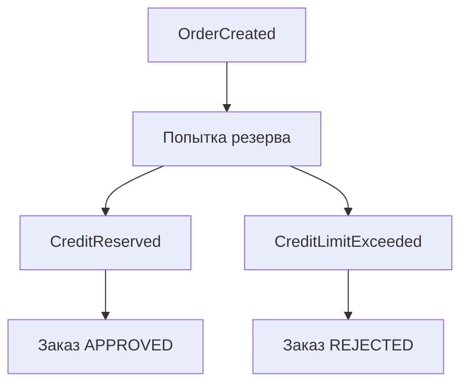

# Архитектура и распределённые системы

## Two-Minute Drill

- При сетевом разделении узлы могут перестать обмениваться данными: тогда доступность и единая актуальная картина вступают в конфликт.
- Saga координирует несколько локальных транзакций через состояния и компенсации, а не делает общий SQL rollback.
- Для внешних вызовов сначала определи timeout, idempotency и поведение при неизвестном результате.

## CAP теорема

Если между двумя группами узлов разорвана сеть (partition), они не могут одновременно знать о новых записях друг друга. В этот момент системе приходится выбирать поведение для затронутых запросов:

- **Consistency (C)** в смысле CAP: чтение ведёт себя как единая актуальная копия (линеаризуемость).
- **Availability (A)**: каждый запрос к работающему узлу получает ответ, а не отказ из-за ожидания другой части кластера.
- **Partition tolerance (P)**: рассматриваем работу при разрыве связи между узлами.

Например, при разрыве связи узел может отказать в записи, чтобы не принять противоречащее изменение (**сохраняет C, теряет A для части запросов**), либо принять запись, но тогда разные части кластера временно дадут несовместимые ответы (**сохраняет A, теряет C**). Фраза «просто выбираем любые два из трёх» скрывает главное: компромисс проявляется **во время сетевого разделения**. Названия продуктов сами по себе не определяют режим всех их операций.

Источник: [объяснение CAP в AWS](https://docs.aws.amazon.com/whitepapers/latest/availability-and-beyond-improving-resilience/cap-theorem.html).

---

## Saga

Покупка в рассрочку требует создать заказ и зарезервировать кредит. У Order Service и Customer Service разные базы. Каждый шаг фиксируется локальной транзакцией. Если кредит недоступен, заказ следует перевести в `REJECTED`. Если после резерва сорвался следующий шаг, освобождение кредита становится самостоятельной компенсирующей транзакцией.

### Хореография

Сервисы реагируют на события о свершившихся фактах. Order Service создаёт `PENDING` и публикует `OrderCreated`. Customer Service пробует зарезервировать кредит, затем публикует один из исходов.

Order Service подписан на оба исхода и завершает заказ. В длинных процессах цепочку событий необходимо восстанавливать по общему идентификатору операции.

### Оркестровка

CreateOrderSaga хранит состояние процесса. После создания заказа она отправляет команду `ReserveCredit` в Customer Service. Ответ `CreditReserved` ведёт к подтверждению заказа, а отказ — к отклонению. При последующем сбое оркестратор может отправить команду `ReleaseCredit`.

| Вариант | Кто выбирает следующий шаг | Где искать состояние |
|---|---|---|
| Хореография | Каждый подписчик реагирует на события | В состояниях сервисов и цепочке событий |
| Оркестровка | Оркестратор отправляет команды и принимает результаты | В сохранённом состоянии саги и связанных сервисах |

Промежуточные состояния видимы. Например, другой запрос может увидеть временно уменьшенный доступный кредит. Идемпотентность защищает от повторной доставки команды. [Transactional Outbox](Transactional-Outbox-and-Idempotency.md) закрывает окно между фиксацией состояния и публикацией события.

## Circuit Breaker

Если провайдер отвечает за десять секунд, а запросы идут непрерывно, занятые сетевые соединения и потоки могут исчерпать ресурсы вызывающего сервиса. Circuit Breaker измеряет исходы вызовов и временно перестаёт отправлять запросы зависимому компоненту. Аналогия со сбрасываемым автоматом из Questions подчёркивает цикл: обнаружить сбой, разомкнуть цепь, проверить восстановление и снова пропускать трафик.

| Состояние | Поведение |
|---|---|
| CLOSED | Пропускает вызовы, собирает статистику |
| OPEN | Временно отклоняет вызовы сразу |
| HALF_OPEN | Пропускает ограниченное число проб. При достаточном успехе закрывается, при сбое открывается снова |

Таймаут клиента ограничивает текущий вызов, circuit breaker управляет допуском следующих. Пул или semaphore отдельно ограничивает число одновременных операций. Ответ приложения при отказе провайдера должен отражать известное состояние. Например, платёж с потерянным ответом остаётся в состоянии сверки.

## Горизонтальное масштабирование

**Вертикальное (Scale Up):** больше CPU/RAM на одном сервере. Ограничено железом.

**Горизонтальное (Scale Out):** добавление новых серверов. Обычно запросы распределяет балансировщик. Чтобы любую реплику можно было заменить, состояние запросов хранят вне неё или явно маршрутизируют трафик. Кэш и шардирование добавляют по результатам измерений. Например, три копии HTTP-сервиса увеличат число одновременных запросов к общей БД, и узкое место может переместиться в неё.

---

## Куда дальше

- [Сеть, события и потоковые протоколы](../API/Network-and-Streaming.md) — OSI, WebSocket, SSE, webhook, backpressure и RSocket.
- [Метрики и перцентили](../Operations/Observability-and-Percentiles.md) — как найти узкое место после масштабирования.
- [Шифрование и TLS](../API/REST-and-Protocols.md#шифрование-и-tls) — как защищается HTTP-трафик.

**Проверь себя.** Почему отказ кредитного сервиса нельзя компенсировать одним SQL rollback? Записи уже могли зафиксироваться в разных локальных транзакциях. Следующие шаги меняют их состояние отдельно.
